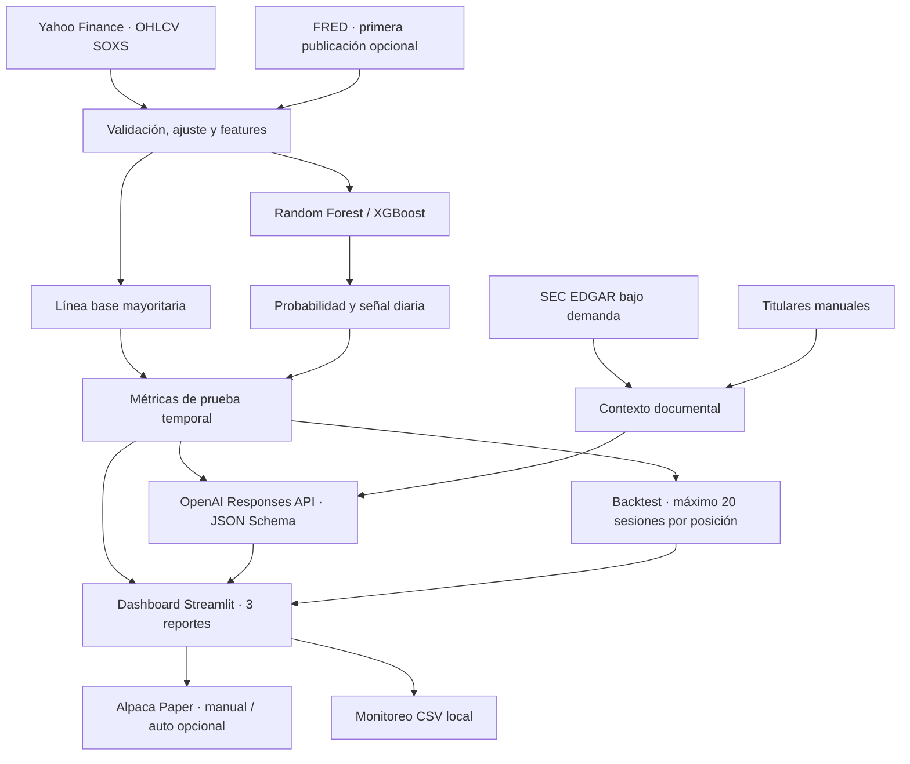

# Arquitectura implementada

## Orden del flujo

1. Se descargan datos diarios ajustados de SOXS. La limpieza valida fecha, cierre, volumen y rango diario; se registran filas y memoria.
2. Se generan features técnicas. Si FRED está disponible, se consultan observaciones de primera publicación y se unen hacia atrás por disponibilidad. SEC y titulares manuales son módulos descriptivos de contexto, no variables históricas del modelo.
3. La etiqueta compara el cierre actual con el próximo cierre. La última fila no tiene etiqueta.
4. La serie se ordena por fecha y se divide 80/20 sin mezclar. Se comparan Random Forest y XGBoost con línea base de clase mayoritaria; el mejor ML por F1 produce probabilidades para el bloque de prueba.
5. Una estrategia de largo SOXS aplica entrada/salida con los umbrales del cuestionario, costo por cambio y tope de 20 sesiones por posición. La referencia SOXS buy-and-hold no tiene tope porque solo compara el mismo periodo de prueba.
6. El reporte prescriptivo llama al LLM únicamente a demanda y valida JSON Schema. El LLM no puede operar el broker.
7. Alpaca Paper es un módulo separado. La cuenta PAPER puede recibir órdenes manuales y el bot PAPER opcional requiere confirmaciones, chequea órdenes duplicadas y antigüedad de posición.

## Componentes

| Archivo | Responsabilidad |
|---|---|
| `app.py` | Dashboard, reportes y acciones del usuario. |
| `soxs/core.py` | OHLCV, calidad/ETL, features, modelos, métricas, selección y backtest. |
| `soxs/sources.py` | FRED, SEC EDGAR y clasificación léxica de textos. |
| `soxs/llm.py` | LLM estructurado, límites y registro. |
| `soxs/paper_broker.py` | Cliente Paper y ciclo automático controlado. |
| `data/` | Logs de LLM, edad de posición y monitoreo local; excluir de Git. |

## Fuera del alcance de la automatización

No se publica el proyecto, no se crean repositorios ni se fabrican capturas, resultados o costos. El equipo completa esas evidencias después de desplegar y probar el servicio con sus propias cuentas.
